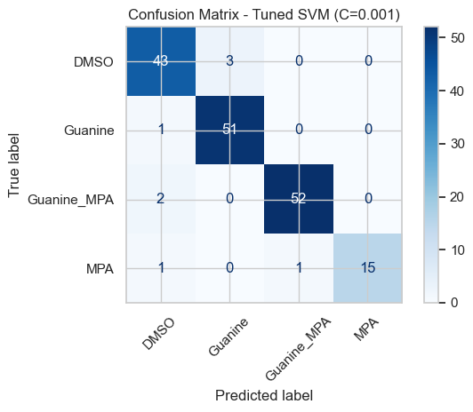
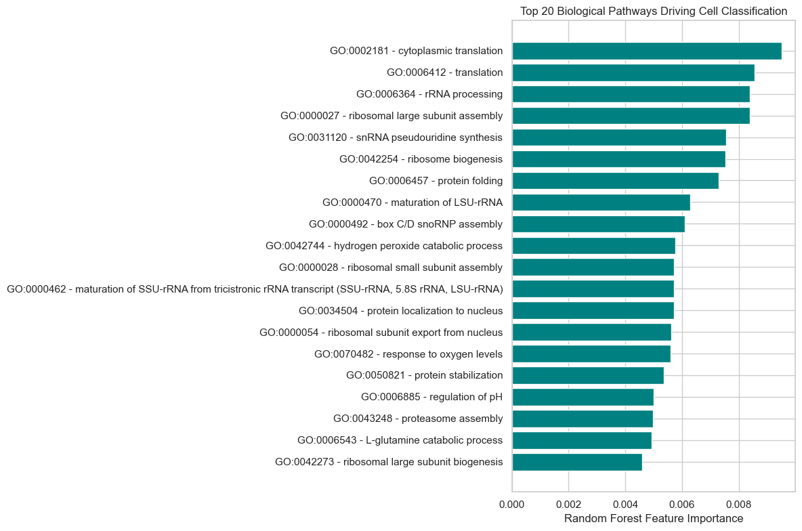

# Classification of Single-Cell Yeast RNA-Seq based on Functional Signatures
Machine learning workflow to classify single-cell RNA-sequencing data (yeastDrop-Seq) based on Gene Ontology (GO) pathway expression indices.

# Data Preparation
The raw dataset are not included in this repository: 
- `GSE165686_yeastdropseq_dge.mtx` (Expression matrix)
- `barcodes.tsv` and `features.tsv` (Matrix Labels)
- `metadata.tsv` (Cell metadata)
- `go-basic.obo` and `YEAST-mod.gaf` (GO and yeast annotations)

# Results
* **Model Performance:** The Linear SVM achieved the highest overall accuracy at **94.1%**, outperforming Logistic Regression (L1) at 92.9% and Random Forest at 83.4%.
* **Hyperparameter Tuning:** Cross-validation demonstrated that a strong regularization parameter ($C=0.001$) maximized the F1-Macro score for the SVM model.
* **Classification Accuracy:** The optimized SVM ($C=0.001$) successfully discriminated between the four cellular conditions (DMSO, Guanine, Guanine_MPA, and MPA) with minimal misclassification, as evidenced by the confusion matrix.
* **Biological Interpretation:** Random Forest feature importance analysis identified translation machinery—specifically cytoplasmic translation, translation, and rRNA processing—as the top biological pathways driving the cellular classification.

  
  

# Install Dependencies
`pip install -r requirements.txt`

MIT License © 2026 Martina Montonati